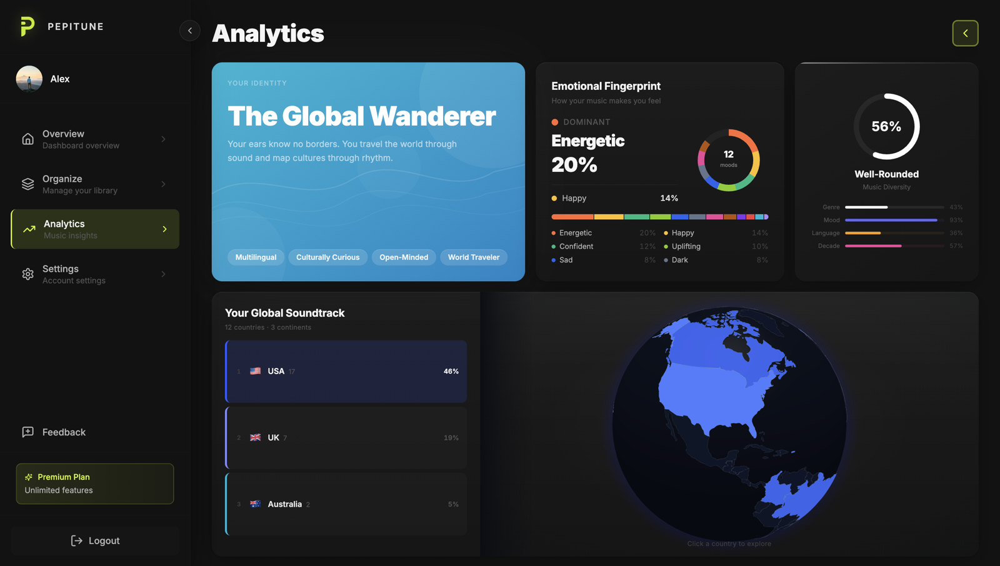
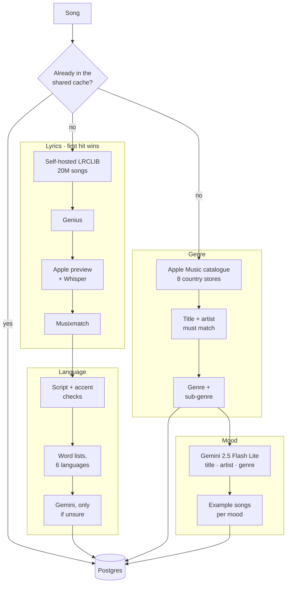
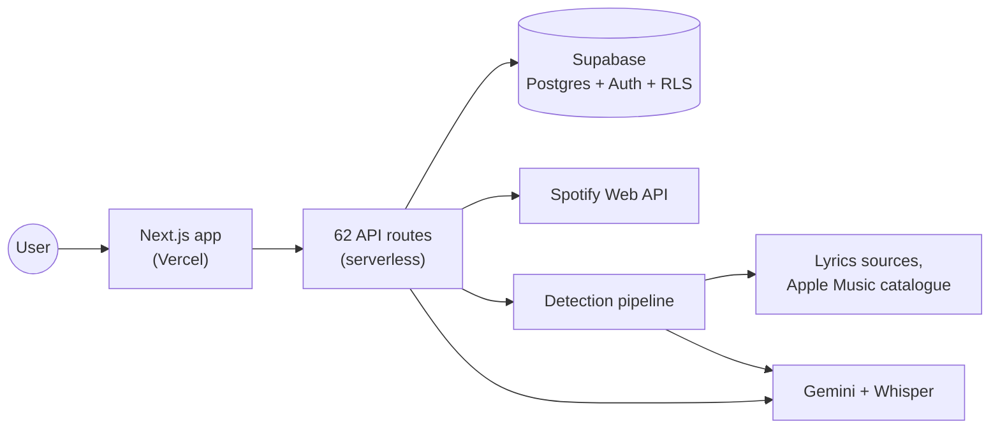

# Pepitune

*Personal project, 2026 · solo build · code is private; this is a write-up.*

**An AI web app that organises an entire Spotify library: it tags every song by genre,
language and mood at ~1,000 songs a minute, then turns those tags into playlists,
insights and a chat assistant.**

| | |
|---|---|
| **Role** | Product, design and full-stack development, solo |
| **Stack** | Next.js 14, TypeScript, Supabase (Postgres), Vercel, Gemini via OpenRouter, Whisper |
| **Scale** | 8+ external services · 62 API endpoints · 59 database migrations · ~1,000 songs/min |
| **Status** | Live at [pepitune.ai](https://pepitune.ai), in private beta |

## The problem

Spotify only knows genre per artist, not per song, and knows nothing about language or
mood. With thousands of liked songs, organising by hand is impossible.

## Features

*Each feature: what it does, then what makes it hard. Animations are from the app's landing page and use its example library.*

### 1. Library sync

Connect Spotify and the whole library comes in: songs, playlists, albums and artists.

**Under the hood:** Spotify OAuth, with paginated sync of the full library into
Postgres. Row-level security in Postgres means users only ever see their own data. Per-user AI quotas and rate limiting keep the paid APIs under control.

### 2. Automatic tagging, the core

Every song gets a **language, genre, sub-genre and mood**, and you can filter by any mix
of them (e.g. Italian + Pop + Energetic).

**Under the hood:** no single source knows all of this, so the app orchestrates **8+
services**: a self-hosted 20M-song lyrics database, Genius, Musixmatch, Apple Music's
catalogue, Whisper speech-to-text and Gemini. It processes 70 songs at a time, falls back
to the next source when one misses, and runs cheap local checks before any paid model
(see [How detection works](#how-detection-works)).

### 3. Playlists

All playlists in one place, including new ones built from tags, synced back to Spotify
in one click.

**Under the hood:** playlists are written back through the Spotify Web API, with tracks
added in batches and a custom cover uploaded. A playlist made in Pepitune is a real
Spotify playlist, not a copy.

### 4. Pepito, the AI assistant

Ask in plain English: "make a chill playlist for a rainy Sunday", "what's my top genre?",
"find energetic songs that aren't in any playlist".

**Under the hood:** the LLM answers with structured JSON actions, chosen from **19 action
types** (filter, stats, create/merge/delete playlists, edit tags, re-run detection…).
Each one is validated against a schema before it runs, and destructive actions wait for
the user to confirm. Vague requests like "workout" are matched against example songs,
then the LLM re-ranks the user's own tracks to pick the ones that fit.

### 5. Analytics

A listening identity ("The Global Wanderer"), your mood mix, and a globe of where your
music comes from.

**Under the hood:** none of this exists in Spotify's data. It's computed from the tags
from step 2, aggregated per user in Postgres.

## How detection works

- **Language** comes from the lyrics: writing system and accents first, then word counts across six languages. Gemini is only asked when the count is unsure, and its answer can overrule it. When the lyrics came from transcribing the audio, Whisper's own language guess is the backup.
- **Genre** comes from Apple Music's catalogue, accepted only when title and artist match, then split into a main genre and a sub-genre.
- **Mood** is classified by Gemini from the title, artist and genre, guided by example songs for each of the 8 moods.

## Architecture

