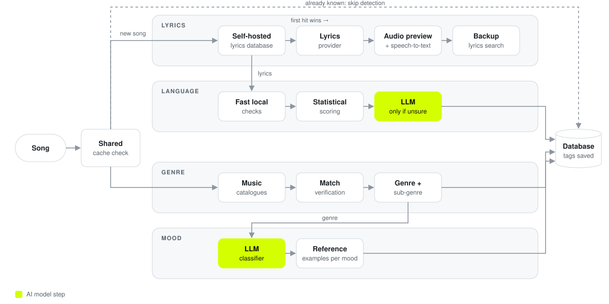
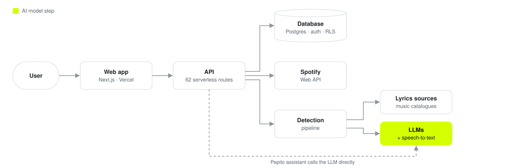

# Pepitune

*Personal project, 2026 · solo build · code is private; this is a write-up.*

**An AI web app that organises an entire Spotify library: it tags every song by genre,
language and mood at ~1,000 songs a minute, then turns those tags into playlists,
insights and a chat assistant.**

| | |
|---|---|
| **Role** | Product, design and full-stack development, solo |
| **Stack** | Next.js 14, TypeScript, Supabase (Postgres), Vercel, LLM APIs, speech-to-text |
| **Scale** | 8+ external services · 62 API endpoints · 59 database migrations · ~1,000 songs/min |
| **Status** | Live at [pepitune.ai](https://pepitune.ai), in private beta |

## The problem

Spotify only knows genre per artist, not per song, and knows nothing about language or
mood. With thousands of liked songs, organising by hand is impossible.

## Features

*Each feature: what it does, then what makes it hard. Animations are from the app's landing page and use its example library.*

### 1. Library sync

Connect Spotify and the whole library comes in: songs, playlists, albums and artists.

**Under the hood:** Spotify OAuth, with paginated sync of the full library into
Postgres. Row-level security in Postgres means users only ever see their own data. Per-user AI quotas and rate limiting keep the paid APIs under control.

### 2. Automatic tagging, the core

Every song gets a **language, genre, sub-genre and mood**, and you can filter by any mix
of them (e.g. Italian + Pop + Energetic).

**Under the hood:** no single source knows all of this, so the app orchestrates **8+
services**: several lyrics sources (including a self-hosted one), music catalogues,
speech-to-text and LLMs. It processes songs in large parallel batches, falls back
to the next source when one misses, and runs cheap local checks before any paid model
(see [How detection works](#how-detection-works)).

### 3. Playlists

Create playlists from the detected tags, in two ways: **pick the filters yourself** (e.g.
Italian + Chill) or **just ask Pepito**. All your playlists live in one place and sync back
to Spotify in one click.

**Under the hood:** playlists are written back through the Spotify Web API, with tracks
added in batches and a custom cover uploaded. A playlist made in Pepitune is a real
Spotify playlist, not a copy.

### 4. Pepito, the AI assistant

Ask in plain English: "make a chill playlist for a rainy Sunday", "what's my top genre?",
"find energetic songs that aren't in any playlist".

**Under the hood:** the LLM answers with structured JSON actions, chosen from **19 action
types** (filter, stats, create/merge/delete playlists, edit tags, re-run detection…).
Each one is validated against a schema before it runs, and destructive actions wait for
the user to confirm. Vague requests like "workout" are matched against example songs,
then the LLM re-ranks the user's own tracks to pick the ones that fit.

### 5. Analytics

A dashboard about your music, built from the tags. Each card shows one thing:

- **Your identity:** a short personality summary of your taste
- **Emotional fingerprint:** your mix of moods and the dominant one
- **Music diversity:** how varied your library is across genre, mood, language and decade
- **Global soundtrack:** an interactive globe of the countries your artists come from
- **Linguistic palette:** the languages you listen to
- **Music universe:** your genres and sub-genres
- **Time machine:** which decades your songs come from
- **Most-loved artists:** the artists that define your library
- **Audio DNA:** the sound of your library, like average tempo

**Under the hood:** none of this exists in Spotify's data. It's computed from the tags
from step 2, aggregated per user in Postgres.

## How detection works

<picture>
  <source media="(prefers-color-scheme: dark)" srcset="../images/pepitune-detection-dark.svg">
  
</picture>

- **Language:** cheap local checks decide most songs. An LLM is only called when they're unsure, which keeps cost low.
- **Genre:** taken from music catalogues, and only accepted when the match is verified.
- **Mood:** an LLM classifier, guided by reference examples for each of the 8 moods.

## Architecture

<picture>
  <source media="(prefers-color-scheme: dark)" srcset="../images/pepitune-architecture-dark.svg">
  
</picture>
