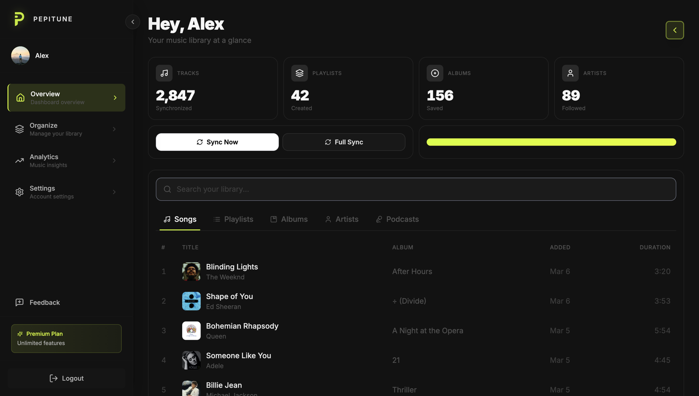
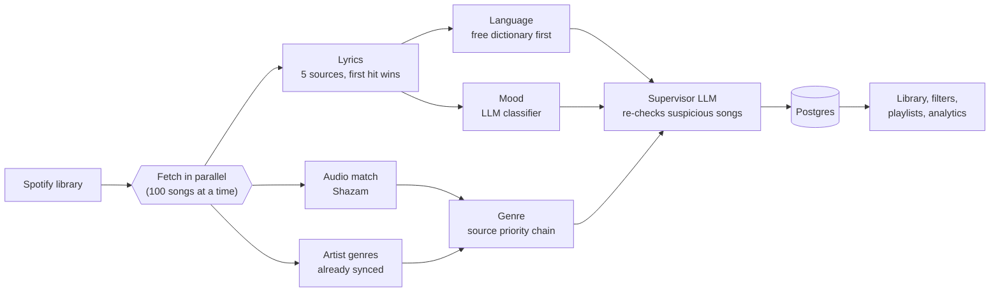
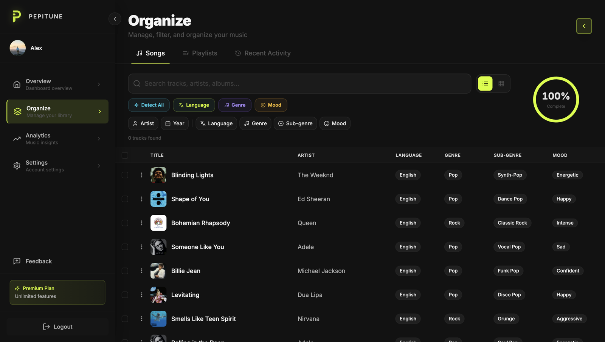
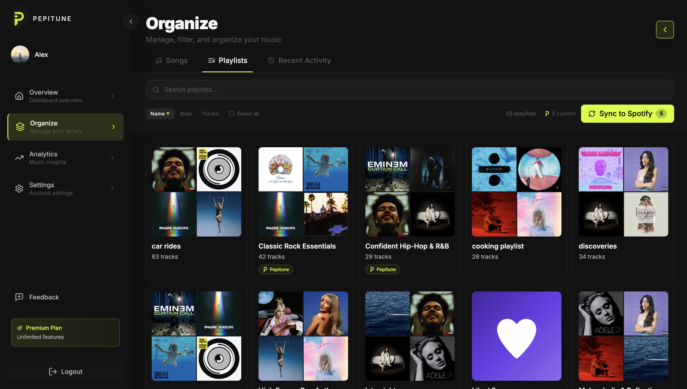
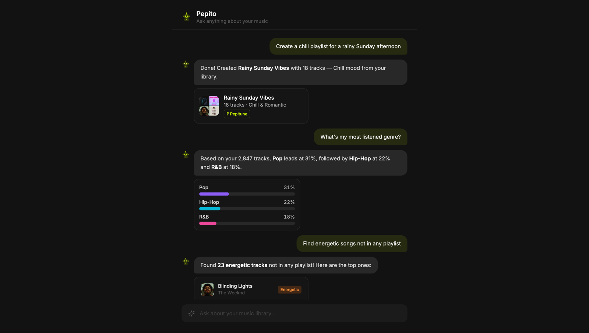

# Pepitune

*Personal project, 2026 · solo build · code is private; this is a write-up.*

<b>Overview</b>: library stats and every song with its tags.

| | |
|---|---|
| **Role** | Product, design and full-stack development, solo |
| **Stack** | Next.js 14, TypeScript, Supabase (Postgres), Vercel, OpenRouter (Gemini Flash Lite), Whisper |
| **Scale** | ~1,000 songs tagged per minute · 62 API endpoints · 10+ external data sources |
| **Status** | Live at [pepitune.ai](https://pepitune.ai), in private beta |

## Problem

Spotify's own genre data is per artist, not per song, and it has no language or mood at
all. A library of thousands of liked songs cannot be organised by hand.

## What I built

A web app that connects to a Spotify account and tags every song by **genre, sub-genre,
language and mood**, then lets you browse, filter and build playlists from those tags.
An AI assistant, **Pepito**, lets you do it all in plain English: "create a chill playlist for a rainy Sunday" and it builds it from your tagged library.

### How it works

- **Every source has a fallback.** Lyrics come from five providers in order. The last
  resort transcribes a 30-second audio preview with Whisper (~$0.003 per song).
- **Free before paid.** Language detection runs on a ~30,000-word local dictionary first.
  Only what it cannot resolve goes to a paid API.
- **A second LLM checks the first.** A supervisor pass re-reviews songs whose tags look
  inconsistent before anything is saved.
- **"Not found" ≠ "nothing there".** A confirmed instrumental and a failed lyrics lookup
  get different values, so the app never confuses the two.

<b>Organize → Songs</b>: filter by language, genre, sub-genre and mood.

## Results

- Tags a full library at **~1,000 songs per minute**.
- **8 moods**, plus genre, sub-genre and language (including bilingual songs) per track.
- Built as a product, not a demo: Spotify OAuth, row-level security in Postgres, per-user
  AI quotas, rate limiting, encrypted secrets, billing and analytics wired in.

<b>Organize → Playlists</b>: playlists built from tags, synced back to Spotify.

<b>Pepito</b>: the built-in AI assistant. Ask in plain English and it builds playlists, answers questions about your library and finds songs.

## Hard parts and decisions

- **Measuring before adding complexity.** For mood I tested four richer approaches: audio
  features in the prompt, lyrics in the prompt, lyric embeddings and audio embeddings.
  **All four lost** to a plain, well-anchored LLM prompt, so the simple version shipped.
- **The mood taxonomy changed three times** (12 → 8 → 6 → 8 moods) as I benchmarked what
  people could actually tell apart. I kept the benchmark history so each change had evidence.
- **Learning from corrections.** When a user fixes a tag, the app can re-tag similar songs.
  Manual edits are protected, so a later automatic run never overwrites them.
- **Rate limits.** The biggest lyrics source is a self-hosted 20M-song dataset with
  failover, so throughput doesn't depend on a third party's quota.

<b>Analytics</b>: your listening identity, mood mix and where your music comes from.

## What I'd do next

- Public launch (currently private beta).
- A proper evaluation set for genre, scored on every pipeline change, like the one mood
  already has.
