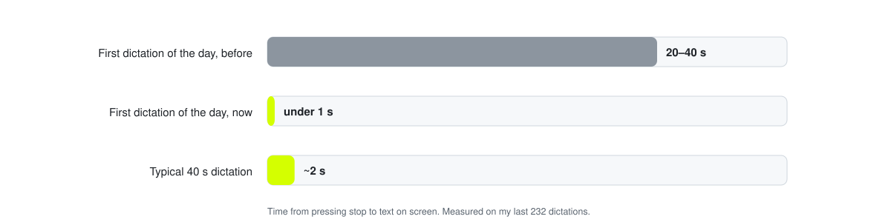

# Voice Pill

*Personal project, 2026 · solo build · code is private; this is a write-up.*

**A free dictation app: press a shortcut, speak, and your words appear wherever you're
typing. It runs entirely on your own computer, on Mac and Windows.**

| | |
|---|---|
| **Role** | Product, design and development, solo |
| **Stack** | Swift, Python, on-device speech-to-text, local AI model |
| **Speed** | ~1 s for a short dictation · ~2 s for 40 s of speech |
| **Status** | Used daily on Mac · Windows version in testing |

## The problem

Good dictation apps cost a monthly subscription and send your voice to the cloud. I
wanted the same thing for free, running on my own computer.

## Features

### 1. Works in any app

Press your shortcut, speak, press it again. The text appears where your cursor is: a
browser, an editor, a chat, even a full-screen app.

**Under the hood:** the small floating pill never steals focus from the app you're
using, so the text always lands in the right place.

### 2. Fast, every time

Short dictations come back in about a second.

**Under the hood:** the speech models take 20–40 s to load. A background helper reloads
them as soon as the computer restarts, so even the first dictation of the day is instant.

<picture>
  <source media="(prefers-color-scheme: dark)" srcset="../images/voicepill-speed-dark.svg">
  
</picture>

### 3. Clean text

Commas, full stops and capital letters are added for you, in any language.

**Under the hood:** a small AI model adds the punctuation, but it can only add punctuation:
it's not allowed to change a single word you said.

<picture>
  <source media="(prefers-color-scheme: dark)" srcset="../images/voicepill-text-dark.svg">
  
</picture>

### 4. Simple setup

The first time you open it, you pick your shortcut and language. Same setup on Mac and Windows.

## How it works

<picture>
  <source media="(prefers-color-scheme: dark)" srcset="../images/voicepill-flow-dark.svg">
  
</picture>

1. **Record:** your shortcut starts and stops the recording.
2. **Turn speech into text:** a speech model on your computer writes down what you said.
3. **Add punctuation and paste:** a small local AI model adds punctuation, then the text is pasted into your app.
