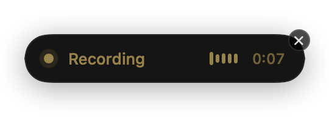

# Voice Pill

*Personal project, 2026 · solo build · code is private; this is a write-up.*

**A free dictation app: press a shortcut, speak, and your words appear wherever you're
typing. It runs entirely on your own computer, on Mac and Windows.**

| | |
|---|---|
| **Role** | Product, design and development, solo |
| **Stack** | Swift, Python, Whisper (speech-to-text), local AI model for punctuation |
| **Speed** | ~1 s for a short dictation · ~2 s for 40 s of speech |
| **Status** | Used daily on Mac · Windows version in testing |

## The problem

Good dictation apps cost a monthly subscription and send your voice to the cloud. I
wanted the same thing for free, running on my own computer.

## Features

### 1. Works in any app

Press your shortcut, speak, press it again. The text appears where your cursor is: a
browser, an editor, a chat, even a full-screen app.

**Under the hood:** the small floating pill never steals focus from the app you're
using, so the text always lands in the right place.

### 2. Clean text

Commas, full stops and capital letters are added for you, in any language.

**Under the hood:** two AI models run on your computer: one listens and writes down what
you say (Whisper), and a second, smaller one adds the punctuation without changing your words.

### 3. Simple setup

The first time you open it, you pick your shortcut and language. Same setup on Mac and Windows.

