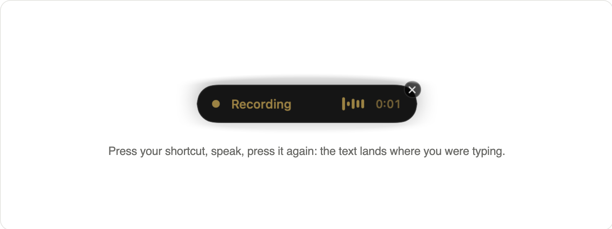
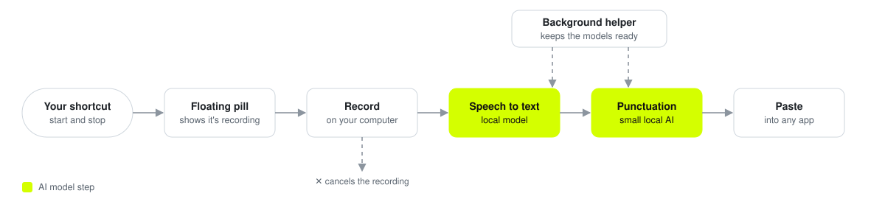

# Voice Pill

*Personal project, 2026 · solo build · code is private; this is a write-up.*

**A free, private alternative to paid AI dictation apps. Press a shortcut, speak, press it
again: the text appears wherever you're typing, in any app. Everything runs on your own
computer, on Mac and Windows.**

| | |
|---|---|
| **Role** | Design and development, solo |
| **Stack** | Swift (AppKit + SwiftUI) on Mac, Python on Windows, on-device Whisper, small local LLM |
| **Speed** | ~1 s for a short dictation · ~2 s for 40 s of speech (median of my last 232) |
| **Cost** | $0: no API calls, no subscription, nothing leaves the computer |

## The problem

I dictate most of my prompts to AI tools. The paid dictation apps cost a monthly
subscription and send your voice to the cloud. The free one I tried couldn't show its
recording pill over other apps, so it silently recorded nothing.

## Features

*Each feature: what it does, then what makes it hard.*

### 1. Dictate into any app

Press your shortcut, speak, press it again. The text is pasted where your cursor was:
in a browser, an editor, a chat or a full-screen app.

**Under the hood:** the pill is a floating panel that **never takes keyboard focus**. If it
did, the paste would land in the pill instead of your app. Finding this took logging:
the old app's framework could only show a normal window, and showing one pulls macOS to
that app's desktop. So I rewrote the client natively instead of patching again. The
Windows version uses the same rule through the Windows API.

### 2. Fast from the very first dictation

**Under the hood:** speech-to-text and punctuation both run on local models that take
20–40 s to load. A background watcher reloads them **as soon as the server restarts**
(nightly, after a reboot or a crash), so the first dictation of the day takes under a
second instead of half a minute.

### 3. Clean, readable text

Punctuation and capital letters are added automatically, even on long dictations.

**Under the hood:** a small local language model adds the punctuation, but it's never
trusted with the words themselves. Its output is aligned word by word against what was
actually said, and only punctuation and capitals are kept. Long dictations are split into
pieces the model handles reliably. I measured an "AI clean-up" step to remove filler
words and dropped it: it made every dictation **~4× slower** for very little gain.

### 4. Your shortcut, on Mac and Windows

A first-run setup lets you pick your own shortcut and a language for it, with an optional
second shortcut for one fixed language. The setup is the same on both platforms.

**Under the hood:** shortcuts are combinations of modifier keys with **left and right
counted separately** (e.g. Right Ctrl + Right Shift), so they never clash with normal
app shortcuts. Both apps share one settings format. On Windows the model runs on the
processor, so it works on any PC, no graphics card needed.

### 5. Safe by default

The **✕** on the pill cancels a recording, and nothing is pasted. If a transcription fails,
the audio is kept so nothing you said is lost. Your clipboard is put back after pasting.

## How it works

<picture>
  <source media="(prefers-color-scheme: dark)" srcset="../images/voicepill-flow-dark.svg">
  
</picture>
