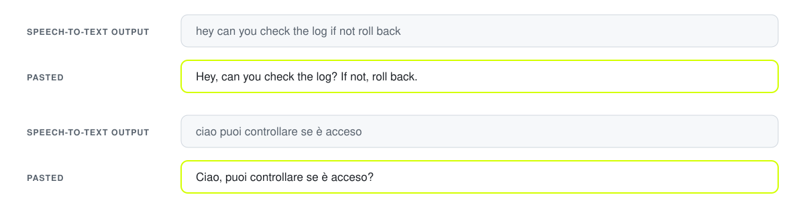
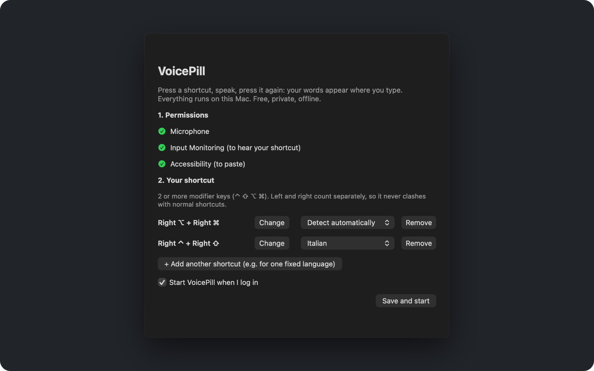
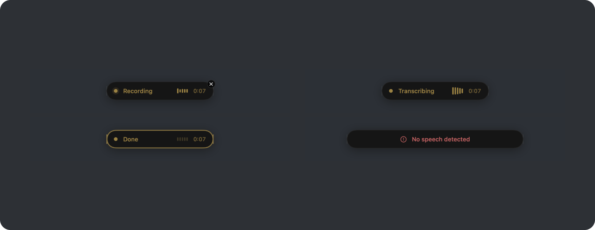
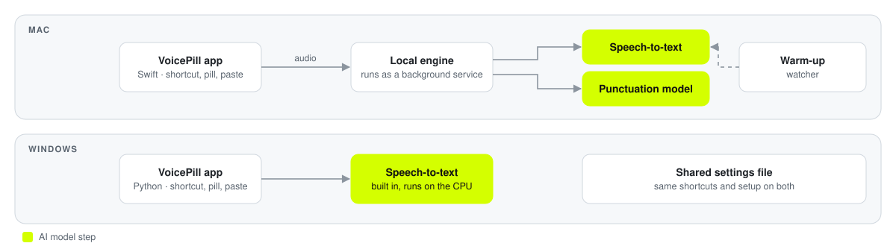

# Voice Pill

*Personal project, 2026 · solo build · code is private; this is a write-up.*

**A free, private alternative to paid AI dictation apps: press a shortcut, speak, and the
text appears wherever you're typing. Speech-to-text and punctuation run entirely on your
own computer, on Mac and Windows.**

| | |
|---|---|
| **Role** | Product, design and development, solo |
| **Stack** | Swift (AppKit, SwiftUI), Python, on-device speech-to-text, local LLM |
| **Scale** | ~1 s per short dictation · ~2 s for 40 s of speech · 230+ real dictations measured |
| **Status** | Used daily on Mac · Windows version in testing |

## The problem

Paid dictation apps charge a monthly subscription and send your voice to the cloud. I
dictate most of my work, so I wanted the same experience for free, fully offline.

## Features

*Each feature: what it does, then what makes it hard. Images are rendered from the app's own interface.*

### 1. Dictation into any app

Press your shortcut, speak, press it again. The text is pasted where your cursor was: a
browser, an editor, a chat, even a full-screen app.

**Under the hood:** the pill is a floating panel that **never takes keyboard focus**, so the
paste always lands in the app you were using. On macOS this needs a non-activating native
panel, which cross-platform UI frameworks can't create, so the client is native Swift.
The Windows version applies the same rule through the Windows API.

### 2. Fast from the first dictation

No warm-up wait, even right after the computer restarts.

**Under the hood:** the two local models (speech-to-text and punctuation) take 20–40 s to
load. A background watcher detects every engine restart (nightly, reboot or crash) and
loads them straight away, so the first dictation of the day is as fast as the rest.

<picture>
  <source media="(prefers-color-scheme: dark)" srcset="../images/voicepill-speed-dark.svg">
  
</picture>

### 3. Clean, readable text

Punctuation and capital letters are added automatically, in any language, even on long
dictations.

**Under the hood:** a small local LLM adds the punctuation, but it's **never trusted with the
words**. Its output is aligned word by word against the transcript and only punctuation and
capitals are kept, so it can't change or drop anything you said. Long dictations are split
into pieces the model handles reliably.

<picture>
  <source media="(prefers-color-scheme: dark)" srcset="../images/voicepill-text-dark.svg">
  
</picture>

### 4. Your shortcut, on Mac and Windows

A first-run setup checks permissions and lets you pick your shortcut and its language,
plus optional extra shortcuts for fixed languages. Same steps on both platforms.

**Under the hood:** shortcuts are combinations of modifier keys with **left and right counted
separately** (e.g. Right Ctrl + Right Shift), so they never clash with normal app shortcuts.
Both apps share one settings format. On Windows the speech model runs on the processor, so
it works on any PC, no graphics card needed.

### 5. Safe by default

The **✕** cancels a recording without pasting anything, and the pill always shows what's
happening.

**Under the hood:** cancelled audio is discarded; if a transcription fails, the recording is
kept so nothing is lost. Only one dictation runs at a time, and your clipboard is restored
after every paste.

## How it works

<picture>
  <source media="(prefers-color-scheme: dark)" srcset="../images/voicepill-flow-dark.svg">
  
</picture>

- **Speech-to-text:** an on-device model; the language is detected automatically or fixed per shortcut.
- **Punctuation:** a small local LLM, with the words locked so only punctuation and capitals change.
- **Warm-up:** both models are reloaded right after any restart, so they're always ready.

## Architecture

<picture>
  <source media="(prefers-color-scheme: dark)" srcset="../images/voicepill-architecture-dark.svg">
  
</picture>
